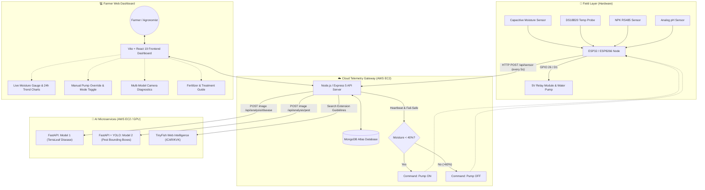

<div align="center">

# 🌾 AgriPulse (TerraLeaf)
### Smart IoT Precision Agriculture & Dual AI Crop Intelligence Platform

An end-to-end precision farming system combining real-time edge IoT soil telemetry, closed-loop automated irrigation, dual computer vision microservices (Wheat Leaf Disease Classification & Pest Detection with YOLO), and an agronomic root-cause advisory dashboard.

<br>

[](frontend)
[](frontend)
[](frontend)
[](backend)
[](backend)
[](backend)
[](ai-service)
[](wheat-pest-api)
[](hardware)
[](#cloud-deployment-aws-ec2)

<br>

[System Architecture](#system-architecture) · [Key Features](#key-features) · [Hardware & Pinouts](#hardware-setup--circuit-pinout) · [AI Models](#ai-models--computer-vision) · [Quick Start](#quick-start-guide) · [API Reference](#api-endpoints-reference) · [Deployment](#cloud-deployment-aws-ec2) · [Troubleshooting](#troubleshooting)

---

</div>

## 📌 What This Is

**AgriPulse** (formerly *AGRI-MOIST-SOIL-DASHBOARD / TerraLeaf*) is an integrated agricultural intelligence ecosystem built to protect and optimize crop yields (specialized for wheat cultivation). 

The platform bridges physical field sensors with high-throughput cloud analytics:
1. **Physical Field Nodes (ESP32 / ESP8266)** stream real-time soil moisture, temperature, pH, and NPK metrics every 3–5 seconds.
2. **Autonomous Closed-Loop Irrigation**: The system monitors soil moisture levels. When moisture falls below the threshold (**< 40%**), the 5V water relay activates automatically until healthy saturation (**> 60%**) is achieved, with full manual override capability from the web console.
3. **Dual Deep Learning Diagnostics**:
   - **Model 1 (TerraLeaf Disease Classifier)**: Deep convolutional neural network (EfficientNet-B0 / Keras) identifying 4 major wheat diseases + healthy status.
   - **Model 2 (Wheat Pest Detection)**: Ultralytics YOLO object detection localized with bounding boxes across 9 destructive wheat pests.
4. **Agronomic Root-Cause & Advisory Engine**: Converts raw detections into actionable treatments (fungicides, biological controls, dosage per acre, spray weather timing, and ICAR/KVK extension guidelines via TinyFish).

---

## 🏗️ System Architecture



---

## ✨ Key Features

| Subsystem | Technology | Capabilities |
|---|---|---|
| **Edge IoT Node** | ESP32 / ESP8266 (C++) | Real-time ADC moisture sampling, RS485 Modbus NPK reading, DS18B20 1-Wire temperature, fail-safe Wi-Fi reconnection, 5V active relay switching. |
| **Telemetry Backend** | Node.js, Express 5, Mongoose | Ingests sensor packets, hardware heartbeat monitor (12s active window), auto-irrigation logic, historical 24h analytics, AI request forwarding. |
| **Disease Classifier** | FastAPI, TensorFlow / PyTorch | High-resolution wheat leaf pathology classification for Yellow Rust, Brown Rust, Powdery Mildew, and Septoria. |
| **Pest Object Detector** | FastAPI, Ultralytics YOLO, OpenCV | Sub-second visual localization and classification for 9 common wheat pests with bounding box coordinates. |
| **Web Dashboard** | React 19, Tailwind CSS, Recharts | Interactive telemetry dashboard, real-time gauges, historical trend analysis, remote irrigation controller, multi-model diagnosis wizard. |
| **Extension Advisory** | TinyFish Intelligence Module | Optional automated query against verified ICAR, KVK, and Ministry of Agriculture databases for dosage and chemical validation. |

---

## 🔌 Hardware Setup & Circuit Pinout

### 1. ESP32 Node Pinout (`hardware/esp32_code/esp32_code.ino`)

| Hardware Component | Component Pin | ESP32 GPIO Pin | Details |
|---|---|---|---|
| **Soil Moisture Sensor** | Analog OUT | **GPIO 34** (ADC1_CH6) | ADC1 channel is safe to use while Wi-Fi is active |
| **5V Relay Module** | Signal IN | **GPIO 26** | Controls 220V/12V submersible irrigation pump |
| **Power Input** | VCC / GND | **VIN (5V) / GND** | Ensure common ground across power supply and relay |

### 2. ESP8266 Node Pinout (`hardware/esp8266_code/esp8266_code.ino`)

| Hardware Component | Component Pin | ESP8266 Pin | Notes |
|---|---|---|---|
| **Capacitive Moisture** | AOUT | **A0** | 10-bit ADC (0 - 1023) |
| **Relay Module (Pump)** | IN | **D1** (GPIO 5) | Active HIGH / LOW switch |
| **DS18B20 Temp Probe** | DATA | **D2** (GPIO 4) | Requires 4.7kΩ pull-up resistor between VCC and DATA |
| **DHT11 / DHT22** | DATA | **D5** (GPIO 14) | Ambient temperature & relative humidity |
| **MAX485 (NPK Sensor)** | RO (RX) / DI (TX) | **D6 / D7** (GPIO 12 / 13) | SoftwareSerial Modbus communication |
| **MAX485 Control** | DE & RE | **D8** (GPIO 15) | Flow control pins tied together |
| **Analog pH Sensor** | PO (Analog) | **A0** (via mux/switch) | pH-4502C analog output |

> [!IMPORTANT]
> Always power the water pump with an **external power adapter** (12V DC or 5V DC depending on the motor rating). Do not draw pump current directly from the ESP32/ESP8266 3.3V pin to prevent brownout resets.

---

## 🔬 AI Models & Computer Vision

### Model 1: TerraLeaf Wheat Disease Classifier (`ai-service/`)
- **Architecture**: EfficientNet-B0 / Custom Convolutional Neural Network
- **Framework**: TensorFlow 2.x / Keras (or PyTorch)
- **Input Resolution**: 224 × 224 × 3
- **Classification Classes**:
  1. `YellowRust` (*Puccinia striiformis*) — Stripe rust forming yellow-orange pustules
  2. `BrownRust` (*Puccinia triticina*) — Leaf rust with scattered brown-orange spores
  3. `Mildew` (*Blumeria graminis*) — Powdery white fungal growth on leaf surface
  4. `Septoria` (*Septoria tritici*) — Necrotic flecks and blotches with pycnidia
  5. `Healthy` — Undamaged, vibrant green foliage

### Model 2: Wheat Pest Detection API (`wheat-pest-api/`)
- **Architecture**: Ultralytics YOLO (YOLO11s / v8)
- **Framework**: PyTorch + OpenCV Headless
- **Inference Output**: Label name, detection confidence (`conf >= 0.15`), and bounding box coordinates `[x1, y1, x2, y2]`
- **Detected Species**:
  1. English Grain Aphid (*Sitobion avenae*)
  2. Green Bug (*Schizaphis graminum*)
  3. Bird Cherry-Oat Aphid (*Rhopalosiphum padi*)
  4. Wheat Blossom Midge (*Sitodiplosis mosellana*)
  5. Penthaleus Major (*Red-legged earth mite*)
  6. Longlegged Spider Mite
  7. Wheat Phloeothrips
  8. Wheat Sawfly
  9. Cerodonta Denticornis (*Wheat leafminer*)

---

## 📁 Repository Layout

```text
├── hardware/                  # Microcontroller firmware
│   ├── esp32_code/            # ESP32 firmware (Wi-Fi + HTTP Telemetry + Relay)
│   └── esp8266_code/          # Multi-sensor ESP8266 firmware (Moisture, NPK, pH, DS18B20)
├── backend/                   # Node.js Express 5 Telemetry Gateway
│   ├── models/                # Mongoose schemas (SensorData, DeviceState, AnalysisRecord)
│   ├── tinyfish/              # Optional ICAR/KVK Agricultural Web Advisory Module
│   ├── server.js              # Central API gateway, auto-irrigation logic & proxy
│   └── package.json
├── frontend/                  # React 19 + Vite 8 Web Application
│   ├── src/
│   │   ├── pages/             # Dashboard, Sensors, MultiModelVision, Weather, Alerts
│   │   ├── components/        # CropAnalysis, PestDetection, AgriPulseBot
│   │   ├── engine/            # RootCauseEngine.js & TreatmentDatabase.js
│   │   └── data/              # Wheat disease reference databases
│   └── package.json
├── ai-service/                # Model 1: Wheat Disease Classification microservice
│   ├── app/                   # FastAPI routes, model loader, and inference logic
│   ├── model/                 # Keras .keras model weights and classes.json
│   └── requirements.txt
├── wheat-pest-api/            # Model 2: YOLO Wheat Pest Detection microservice
│   ├── app/                   # FastAPI + Ultralytics YOLO inference pipeline
│   ├── Dockerfile
│   └── requirements.txt
├── agri-pulse-ml/             # Standalone PyTorch EfficientNet-B0 inference pipeline
├── deploy.sh                  # AWS EC2 automated deployment script
└── model2_nginx.conf          # Nginx reverse proxy configuration for pest detection API
```

---

## 🚀 Quick Start Guide

### Prerequisites
- **Node.js** (v20.x or newer) and `npm`
- **Python** (3.10 or 3.11) with `pip`
- **MongoDB** (Local instance or MongoDB Atlas connection URI)
- **Arduino IDE** (with ESP32 / ESP8266 board support installed)

---

### Step 1: Clone the Repository
```bash
git clone https://github.com/ommaurya2580-beep/AGRI-MOIST-SOIL-DASHBOARD.git
cd AGRI-MOIST-SOIL-DASHBOARD
```

---

### Step 2: Configure & Start Backend
1. Navigate to the backend folder:
   ```bash
   cd backend
   npm install
   ```
2. Copy environment file and configure variables:
   ```bash
   cp .env.example .env
   ```
   *Edit `.env` with your values:*
   ```env
   MONGO_URI=mongodb+srv://<username>:<password>@cluster.mongodb.net/iot_dashboard
   PORT=5000
   MODEL1_URL=http://localhost:8000/api/v1/disease/predict
   MODEL2_URL=http://localhost:8001/predict
   ```
3. Start the backend:
   ```bash
   node server.js
   # Output: Server running on port 5000 | MongoDB Connected
   ```

---

### Step 3: Start Frontend Dashboard
```bash
cd ../frontend
npm install
npm run dev
# Dashboard available at: http://localhost:5173
```

---

### Step 4: Run AI Microservices

#### Disease Classification (Port 8000):
```bash
cd ../ai-service
python -m venv venv
# On Windows:
venv\Scripts\activate
# On Linux/macOS:
source venv/bin/activate

pip install -r requirements.txt
uvicorn app.main:app --host 0.0.0.0 --port 8000 --reload
```

#### Pest Detection (Port 8001):
```bash
cd ../wheat-pest-api
pip install -r requirements.txt
uvicorn app.main:app --host 0.0.0.0 --port 8001 --reload
```

---

### Step 5: Flash Hardware Node
1. Open `hardware/esp32_code/esp32_code.ino` in Arduino IDE.
2. Update your local Wi-Fi credentials:
   ```cpp
   const char* ssid = "YOUR_WIFI_SSID";
   const char* password = "YOUR_WIFI_PASSWORD";
   ```
3. Update server endpoint:
   ```cpp
   // For local testing: use your PC's LAN IP (e.g., http://192.168.1.10:5000/api/sensor)
   const char* serverUrl = "http://YOUR_SERVER_IP:5000/api/sensor";
   ```
4. Select board **ESP32 Dev Module** and upload. Open Serial Monitor at **115200 baud** to view real-time transmission logs.

---

## 📡 API Endpoints Reference

### 1. IoT & Telemetry Endpoints

| Method | Endpoint | Description | Sample Request / Response |
|---|---|---|---|
| `GET` | `/api/state` | Returns live hardware connectivity status, current sensor telemetry, and pump status. | `{ "isOnline": true, "currentMoisture": 48, "readings": {...} }` |
| `POST` | `/api/sensor` | Primary ingestion endpoint called by ESP32/ESP8266 nodes every 5s. Returns relay command. | **Body:** `{ "moistureLevel": 38, "temperature": 24.5, "pH": 6.8 }`<br>**Response:** `{ "success": true, "pumpIsOn": true }` |
| `GET` | `/api/sensor` | Checks the timestamp of the latest received hardware packet. | `{ "isLive": true, "ageSeconds": 3 }` |
| `GET` | `/api/trend` | Returns 24-hour historical trend points for Moisture, Temperature, pH, N, P, and K. | `{ "Moisture": [{ "time": "12 AM", "value": 45 }, ...] }` |
| `POST` | `/api/control` | Updates irrigation pump state or switches between Auto Mode and Manual Override. | **Body:** `{ "isAutoMode": false, "pumpIsOn": true }` |
| `POST` | `/api/sensor/simulate` | Generates a mock telemetry packet for offline UI demonstration without hardware. | `{ "success": true, "message": "Simulation Demo Packet Recorded" }` |

### 2. Multi-Model AI Diagnostics

| Method | Endpoint | Description |
|---|---|---|
| `POST` | `/api/analysis/disease` | Accepts `multipart/form-data` with `image` and `crop`. Proxies to Model 1 and records diagnosis in MongoDB. |
| `POST` | `/api/analysis/pest` | Accepts `multipart/form-data` with `image`. Proxies to Model 2 YOLO service and returns detected pest bounding boxes. |
| `POST` | `/api/tinyfish/advisories` | Queries verified agricultural extension literature (ICAR / KVK) for confirmed dosages. |

---

## ☁️ Cloud Deployment (AWS EC2)

The architecture is pre-configured for cost-effective distributed deployment across AWS EC2 instances:

```text
Instance 1: Telemetry & Web Dashboard (Public IP: 13.50.151.133)
  ├── Node.js Express 5 API Server (Port 80 / PM2)
  └── Static React Build (/frontend/dist)

Instance 2: TerraLeaf Disease Classifier (Public IP: 16.192.162.67)
  └── FastAPI + TensorFlow Keras (Port 8000)

Instance 3: Wheat Pest Detection (Public IP: 13.50.81.200)
  ├── FastAPI + Ultralytics YOLO (Port 8000)
  └── Nginx Reverse Proxy (Port 80 -> Port 8000)
```

### Deploying the Central Node Server (`deploy.sh`)
```bash
# SSH into your EC2 Ubuntu/Amazon Linux instance
chmod +x deploy.sh
./deploy.sh
```

The script will automatically:
1. Update packages and install Node.js 20.x, Git, and PM2.
2. Clone repository and install backend dependencies.
3. Generate the production `.env` with MongoDB Atlas connection string.
4. Launch the application daemonized under PM2 on port 80.

---

## 🛠️ Troubleshooting

| Issue | Cause | Solution |
|---|---|---|
| **Dashboard shows "Offline (Disconnected)"** | No telemetry packet received in the last 12 seconds. | Check ESP32 Serial Monitor (115200 baud). Verify that Wi-Fi SSID, password, and the target backend IP address in `esp32_code.ino` are correct. |
| **Relay does not trigger pump** | Logic inversion or insufficient supply current. | Verify whether your relay module is **Active LOW** or **Active HIGH**. If active LOW, invert `digitalWrite(RELAY_PIN, HIGH/LOW)` in code. Power the relay using an external 5V power supply. |
| **AI Disease Diagnosis times out** | Model 1 service unreachable. | Verify the EC2 security group allows inbound HTTP traffic on port 80/8000. Ensure `MODEL1_URL` in `backend/.env` is accessible via `curl`. |
| **Pest Detection returns empty boxes** | Confidence below threshold. | Check image lighting and focus. The default threshold is `conf = 0.15`. Ensure input images have clear visibility of the foliage and pests. |
| **MongoDB Atlas connection refused** | IP Whitelist restriction. | Go to MongoDB Atlas Console → **Network Access** → Add Current IP Address or enable `0.0.0.0/0` (Allow Access from Anywhere). |

---

## 👥 Contributors & Acknowledgements

- **Lead Developer**: Om Maurya ([@ommaurya2580-beep](https://github.com/ommaurya2580-beep))
- **Research & Agronomy Guidelines**: ICAR (Indian Council of Agricultural Research) & Krishi Vigyan Kendra (KVK) Extension Protocols.
- **Computer Vision Frameworks**: Ultralytics YOLO & TensorFlow / PyTorch Community.

---

<div align="center">
  <sub>Built with ❤️ for precision farming and sustainable crop health management.</sub>
</div>
